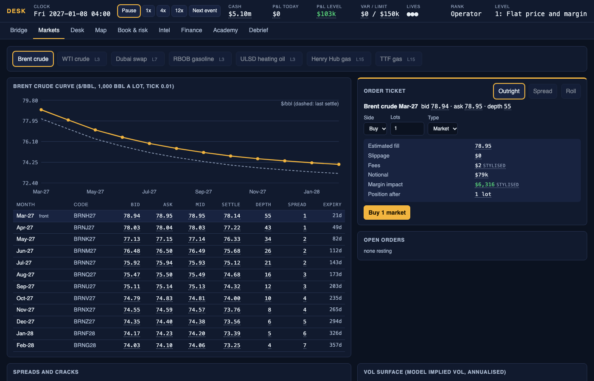
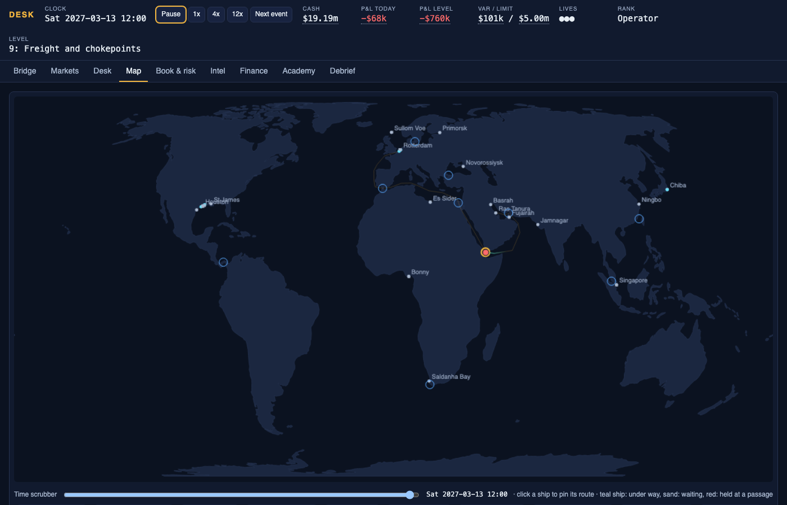
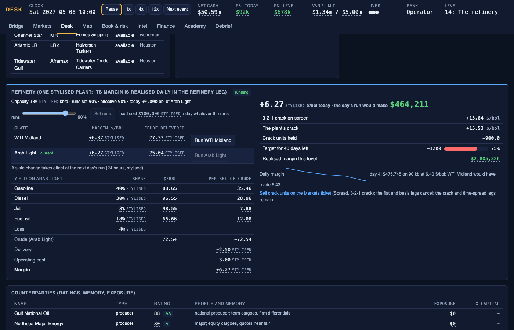
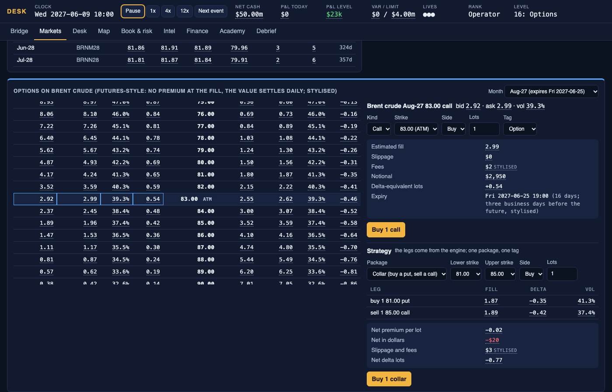

# DESK

A single-player commodity trading game: a trader's desk with everything a real desk has, run on an accelerated clock,
with a curriculum that teaches the job one concept at a time by making you do it and lose money safely when you get it
wrong.

**Play it:** https://pierrelec12.github.io/c-game/ (static, offline after load, nothing to install; level 0 takes two
minutes).

All five milestones are built: tiers 0 to 5 (levels 0 to 20), the engine core with cargoes, pricing windows, ships, routes and
chokepoints on a bundled coastline, letters of credit, prepayment, a covenant, insurance, counterparties with ratings and memory,
tanks and blending, delayed headlines and rumours, a refinery with yields and a slate, the LNG chain from Sabine Pass to Gate or
Sodegaura with the euro leg, options on the book with Greek attribution, signals that arrive before the news, four stylised crises
on an inherited book (a squeeze into expiry below zero among them), a full quarter with a budget, Partner with adversarial
counterparties and a fresh seed every run, sandbox mode, a leaderboard against your own past runs, the Bridge, Markets, Desk, Map,
Book and risk, Intel, Finance and Academy screens, saves, and the debrief with a solution-bot ghost line and what-if replays.









## What it teaches (tiers 1 to 5)

Lots, ticks and settles; sizing to a VaR limit before choosing a direction; initial and variation margin and what a
margin call does; contango, backwardation, full carry and the roll; spreads as packages, Brent-WTI and the 3-2-1 crack;
releases, consensus and surprise, positioning as a crowd, a leak's base rate. Then the cargo: FOB, CIF and DES, the laycan
and the bill of lading, a pricing window as an exposure, lots from barrels, hedging the window in a month that outlives it,
basis and grade differentials, selling East on Dubai, the EFP, the hidden time spread in mismatched windows, freight as a
share of the barrel, a restricted strait as a freight shock and a time spread at once, storage on water. Then the money: working capital, letters
of credit, prepayment as a loan, the cheapest name for a reason, concentration, due diligence, VaR as a quantile, gross versus
net, reducing before you are told, cash and carry, storage economics, blending to a spec. Then the products, gas, options and
signals: yields and the slate, the seasonality of cracks, a turnaround as a supply event, MMBtu against MWh against cubic metres,
the netback, storage as the gas curve, Black-76 in one screen, delta as a hedge ratio that moves, vol as a price, lags, signal
against noise, what a transit count can and cannot tell you. Then mastery: a squeeze into expiry and why a landlocked contract
can settle below zero, a hedge without a cargo as a position, liquidity as a regime, a quarter judged on the number and on how it
was made, and a market that knows what you hold. Every number on screen explains itself on hover. Every reference figure is
labelled stylised.

## Run it locally

```
pnpm install
pnpm test          # engine, content and UI component tests
pnpm dev           # http://localhost:5173/c-game/
pnpm build         # static site in apps/web/dist
pnpm e2e           # Playwright smoke test of level 0 on the built site (pnpm exec playwright install chromium first)
pnpm screenshots   # retakes docs/screenshots/
```

## Layout

```
packages/engine    the simulation: pure TypeScript, no DOM, no I/O; tick(state, actions, rng) -> next state
packages/content   the curriculum: levels, cards, drills, mentor, glossary
apps/web           React + Vite, the screens, the clock, IndexedDB saves
docs/              DESIGN.md (as built, with every deviation from the prompt), LEVELS.md, screenshots/
```

Built from `BUILD_PROMPT.md`. Not part of, and not depending on, c-terminal; the options maths, the historical VaR and
the conversion constants were re-implemented from it with the same tests.
